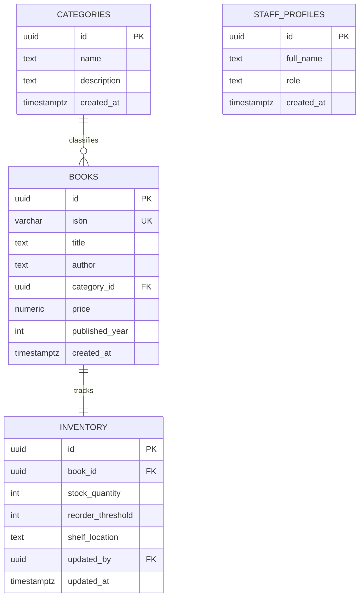

# Paper Trail Books — Inventory Database & RLS Architecture

A relational PostgreSQL database schema and Row-Level Security (RLS) setup built on **Supabase** for **Paper Trail Books** to track book catalog records, categories, stock levels, and staff permissions.

---

## Entity Relationship Diagram (ERD)



```

paper-trail-books-inventory/
├── src/
│   ├── app/
│   │   └── api/
│   │       ├── books/
│   │       │   ├── route.ts                 # GET (list/filter books) & POST (create book + inventory)
│   │       │   └── [id]/
│   │       │       └── inventory/
│   │       │           └── route.ts         # PATCH (update stock & low-stock flag) & DELETE
│   │       └── inventory/
│   │           └── low-stock/
│   │               └── route.ts             # GET low-stock alerts (stock_quantity <= 5)
│   └── lib/
│       ├── supabase/
│       │   └── server.ts                    # Request-scoped Supabase client forwarding Bearer JWTs
│       └── validations/
│           └── inventory.ts                 # Zod schemas for book creation and inventory updates
├── supabase/
│   └── migrations/
│       ├── 001_initial_schema.sql           # Tables, foreign keys, constraints, indexes, and role grants
│       └── 002_rls_policies.sql             # Row-Level Security policies and staff verification helper
├── scripts/
│   ├── seed_books.py                        # Python script to seed 4 categories and 20 sample books
│   └── test_rls.py                          # RLS verification script (anon, non-staff, and staff paths)
├── .gitignore                               # Excludes .env, .env.local, and local cache files
├── package.json                             # Next.js, TypeScript, Zod, and Supabase dependencies
└── README.md                                # Schema ERD, architectural decisions, and API docs

```

---

## Architecture & Security Decisions

* **Normalized Relational Schema:** Separated static catalog metadata (`books`) from mutable stock counts (`inventory`) using a 1-to-1 foreign key relationship (`book_id`) to prevent row-locking contention during frequent inventory updates.
* **Data Integrity Constraints:** Enforced `CHECK` constraints for non-negative prices (`price >= 0`), non-negative stock (`stock_quantity >= 0`), valid publication years, and strict role validation (`admin`, `manager`, `staff`).
* **Low-Stock Indexing:** Added a partial index (`idx_inventory_low_stock`) on `stock_quantity <= 5` to accelerate low-stock alert queries.
* **Row-Level Security (RLS):** Enabled RLS across all public tables. Unauthenticated (`anon`) users have **zero read or write permissions** (`42501` permission denied on both `SELECT` and `INSERT`), while all `INSERT`, `UPDATE`, and `DELETE` operations validate `auth.uid()` against `staff_profiles` via a `SECURITY DEFINER` function (`is_authenticated_staff()`) with `SET search_path = public` pinned to prevent search-path shadowing.

* **Staff Provisioning Security:** Intentionally omitted an `INSERT` policy on `staff_profiles` so authenticated users cannot self-promote to staff roles; new staff records can only be provisioned via the privileged `service_role` key.

---

## Setup & Verification

1. Run `supabase/migrations/001_initial_schema.sql` in the **Supabase SQL Editor** to create tables, constraints, indexes, and role grants.
2. Run `supabase/migrations/002_rls_policies.sql` to enable RLS and apply split staff write policies.
3. Configure your `.env` file (`SUPABASE_URL`, `SUPABASE_SERVICE_ROLE_KEY`, `SUPABASE_ANON_KEY`, and test credentials) and run:
   ```bash
   pip install supabase python-dotenv
   python scripts/seed_books.py
   python scripts/test_rls.py
   ```

---

## REST API Endpoints (Next.js App Router)

All endpoints require an authenticated Supabase staff JWT in the `Authorization` header (`Authorization: Bearer <token>`) and enforce PostgreSQL Row-Level Security (`is_authenticated_staff()`) alongside Zod request validation.

---

### 1. `/api/books` (`GET`, `POST`)

Lists books joined with category and inventory details (with optional filtering/pagination), or creates a new book alongside its 1-to-1 `inventory` record.

* **Query Parameters (`GET`):** `?page=1&limit=8&category_id=<uuid>&search=<term>`
* **Request Body (`POST`):**
  ```json
  {
    "isbn": "9780140449136",
    "title": "Crime and Punishment",
    "author": "Fyodor Dostoevsky",
    "category_id": "f28a41de-a752-47f3-a454-46f6383db550",
    "price": 18.99,
    "published_year": 1866,
    "stock_quantity": 3,
    "reorder_threshold": 5,
    "shelf_location": "A-12"
  }
  ```
* **Responses:**
  * **`200 OK` (`GET`) / `201 Created` (`POST`):**
    ```json
    {
      "data": {
        "id": "7d35ee70-f21b-4ff4-ad28-a5fd3708b77a",
        "isbn": "9780140449136",
        "title": "Crime and Punishment",
        "author": "Fyodor Dostoevsky",
        "category_id": "f28a41de-a752-47f3-a454-46f6383db550",
        "price": 18.99,
        "published_year": 1866,
        "inventory": {
          "stock_quantity": 3,
          "reorder_threshold": 5,
          "shelf_location": "A-12"
        }
      }
    }
    ```
  * **`400 Bad Request` (Zod validation failure):**
    ```json
    {
      "error": "Validation failed",
      "details": {
        "fieldErrors": {
          "price": ["Price cannot be negative"]
        }
      }
    }
    ```
  * **`401 Unauthorized` (Missing or invalid Bearer token):**
    ```json
    {
      "error": "Unauthorized: valid staff token required"
    }
    ```
  * **`404 Not Found` (Referenced `category_id` or resource not found / invalid route):**
    ```json
    {
      "error": "Resource not found"
    }
    ```

---

### 2. `/api/books/[id]/inventory` (`PATCH`, `DELETE`)

Updates stock quantity, reorder threshold, or shelf location for a specific book (returning `low_stock_alert: true` when `stock_quantity <= reorder_threshold`), or deletes the book and its linked inventory record.

* **Path Parameter:** `id` — Book UUID (`uuid`)
* **Request Body (`PATCH`):**
  ```json
  {
    "stock_quantity": 4,
    "reorder_threshold": 5,
    "shelf_location": "B-08"
  }
  ```
* **Request Body (`DELETE`):** None
* **Responses:**
  * **`200 OK` (`PATCH`):**
    ```json
    {
      "data": {
        "id": "41a62e54-9103-4765-aa0b-87b7647a311d",
        "book_id": "7d35ee70-f21b-4ff4-ad28-a5fd3708b77a",
        "stock_quantity": 4,
        "reorder_threshold": 5,
        "shelf_location": "B-08",
        "updated_by": "bf49930f-743f-4d3c-8f19-1060ec4b2bbc",
        "updated_at": "2026-11-25T16:13:23.947+00:00"
      },
      "low_stock_alert": true
    }
    ```
  * **`400 Bad Request` (Invalid UUID format or negative stock count):**
    ```json
    {
      "error": "Invalid book ID format (UUID expected)"
    }
    ```
  * **`401 Unauthorized` (Missing or invalid Bearer token):**
    ```json
    {
      "error": "Unauthorized: valid staff token required"
    }
    ```
  * **`404 Not Found` (Valid UUID with no matching inventory or book row):**
    ```json
    {
      "error": "Inventory record not found for this book"
    }
    ```

---

### 3. `/api/inventory/low-stock` (`GET`)

Fetches all books whose `stock_quantity` is at or below the low-stock threshold (`<= 5`), backed by the partial index `idx_inventory_low_stock`.

* **Request Body:** None
* **Responses:**
  * **`200 OK`:**
    ```json
    {
      "data": [
        {
          "id": "41a62e54-9103-4765-aa0b-87b7647a311d",
          "stock_quantity": 4,
          "reorder_threshold": 5,
          "shelf_location": "B-08",
          "updated_at": "2026-11-25T16:13:23.947+00:00",
          "books": {
            "id": "7d35ee70-f21b-4ff4-ad28-a5fd3708b77a",
            "isbn": "9780140449136",
            "title": "Crime and Punishment",
            "author": "Fyodor Dostoevsky",
            "price": 18.99
          }
        }
      ]
    }
    ```
  * **`400 Bad Request` (Invalid query parameters):**
    ```json
    {
      "error": "Invalid request parameters"
    }
    ```
  * **`401 Unauthorized` (Missing or invalid Bearer token):**
    ```json
    {
      "error": "Unauthorized: valid staff token required"
    }
    ```
  * **`404 Not Found` (Endpoint or resource not found):**
    ```json
    {
      "error": "Resource not found"
    }
    ```
