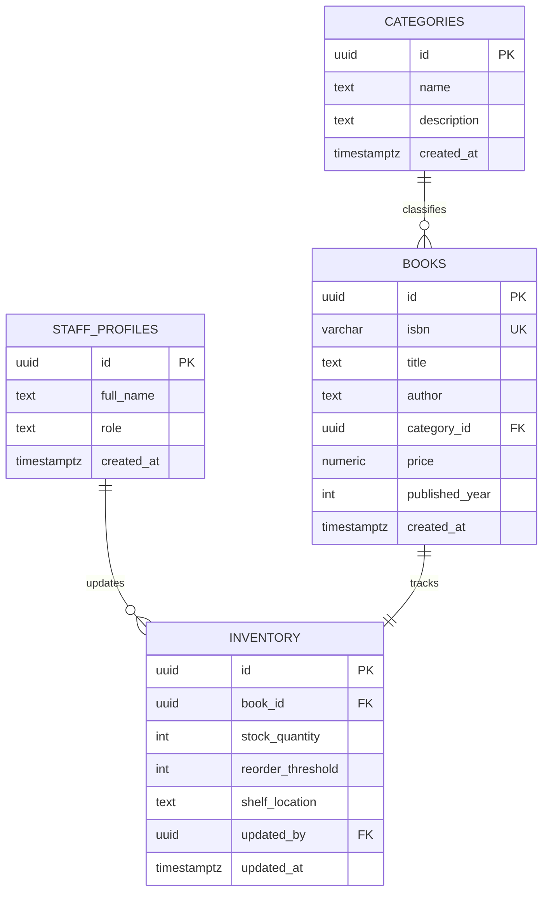

# Paper Trail Books — Inventory Database & RLS Architecture

A relational PostgreSQL database schema and Row-Level Security (RLS) setup built on **Supabase** for **Paper Trail Books** to track book catalog records, categories, stock levels, and staff permissions.

---

## Entity Relationship Diagram (ERD)



---

## Repository Structure

```text
paper-trail-books-inventory/
├── supabase/
│   └── migrations/
│       ├── 001_initial_schema.sql   # Tables, foreign keys, constraints, indexes, and role grants
│       └── 002_rls_policies.sql     # Row-Level Security policies and staff verification helper
├── scripts/
│   └── seed_books.py                # Python script to seed 4 categories and 20 sample books
└── README.md                        # Schema ERD and architectural decisions
```

---

## Architecture & Security Decisions

* **Normalized Relational Schema:** Separated static catalog metadata (`books`) from mutable stock counts (`inventory`) using a 1-to-1 foreign key relationship (`book_id`) to prevent row-locking contention during frequent inventory updates.
* **Data Integrity Constraints:** Enforced `CHECK` constraints for non-negative prices (`price >= 0`), non-negative stock (`stock_quantity >= 0`), valid publication years, and strict role validation (`admin`, `manager`, `staff`).
* **Low-Stock Indexing:** Added a partial index (`idx_inventory_low_stock`) on `stock_quantity <= 5` to accelerate low-stock alert queries.
* **Row-Level Security (RLS):** Enabled RLS across all public tables. Unauthenticated (`anon`) users have zero write permissions, while all `INSERT`, `UPDATE`, and `DELETE` operations validate `auth.uid()` against `staff_profiles` via a `SECURITY DEFINER` function (`is_authenticated_staff()`).

---

## Setup & Seeding

1. Run `supabase/migrations/001_initial_schema.sql` in the **Supabase SQL Editor** to create tables, constraints, indexes, and role grants.
2. Run `supabase/migrations/002_rls_policies.sql` to enable RLS and apply authenticated staff write policies.
3. Configure `SUPABASE_URL` and `SUPABASE_SERVICE_ROLE_KEY` in your environment and run:
   ```bash
   pip install supabase python-dotenv
   python scripts/seed_books.py
   ```
